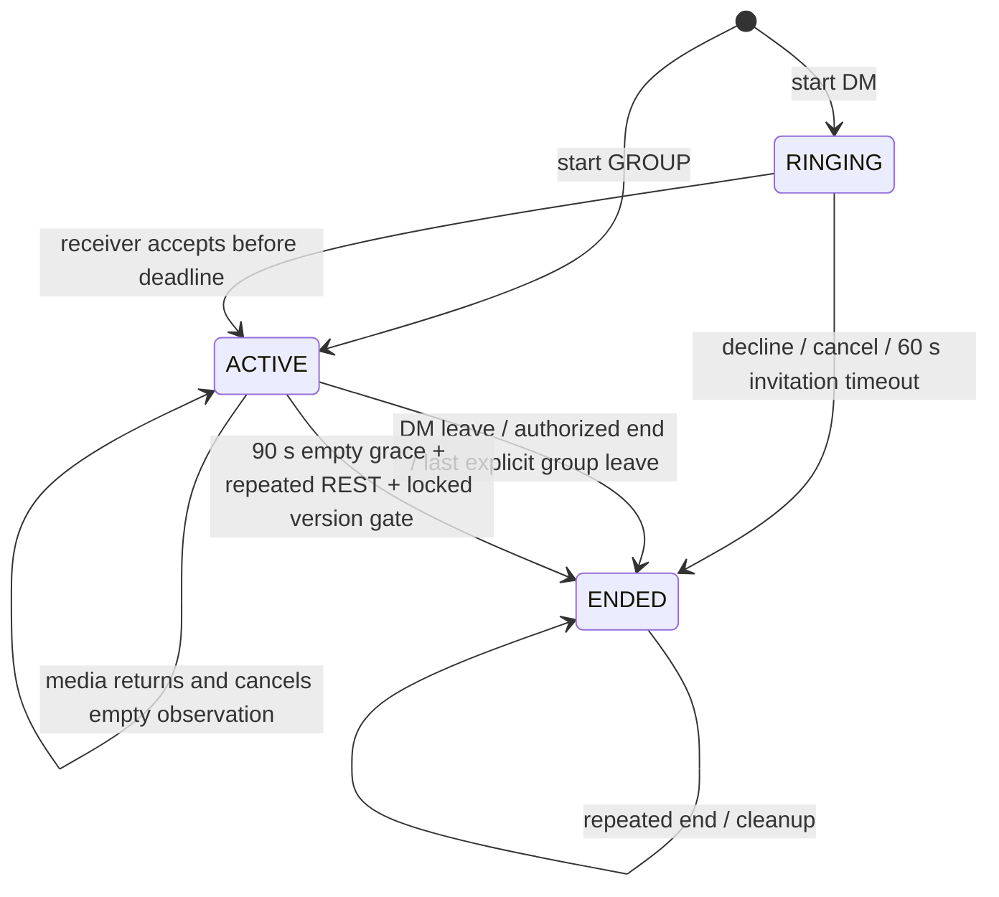

# Zvonok Core Stabilization — Stage 5: Reliable Call Lifecycle

Дата завершения: 2026-10-18, Asia/Yekaterinburg.
Scope: W01, существующие DM/GROUP calls, LiveKit SDK/server SDK 0.7.0, REST и STOMP. Stage 6 не начинался.

## 1. Результат и границы проверки

Исправлены восстановление и согласование frontend, идемпотентность участия, cleanup приглашений и пустых медиасессий. Новая система звонков не создавалась. Согласованные пользователем интервалы: приглашение 60 секунд, media grace 90 секунд только после успешного REST-наблюдения отсутствия участников. Перед окончательным cleanup повторяется REST-проверка и проверяется версия/статус CallSession под блокировкой.

Предыдущие Stage 1–4 изменения сохранены. Прочитаны SECURITY-P0.md, CORE-STABILIZATION-STAGE2.md, CORE-STABILIZATION-STAGE3.md, security follow-up и CORE-CLEANUP-STAGE4.md; перед изменениями проверены status/diff обоих репозиториев. Коммиты, production операции, изменения .factorypath и старой Server/Channel системы не выполнялись. Canvas/Whiteboard/Code Sessions/Hub не возвращались. PostgreSQL tests использовали только собственный временный Testcontainers контейнер; существующие PostgreSQL/S3 данные не затрагивались.

Проверена реальная PostgreSQL persistence и конкурентность. Реальный LiveKit SFU и два физических клиента не использовались: полная media-приёмка остаётся обязательной. Web/Electron builds не равнозначны запуску двух клиентов или установщика.

## 2. Фактический Call Lifecycle

REST /calls и STOMP /app/call используют существующий CallService → CallSessionService. Start блокирует Room, проверяет отсутствие действующей CallSession, сохраняет уникальное имя dm-{room}-call-{id} / group-{room}-call-{id} и участников. Приглашения и события отправляются после commit.

DM создаётся RINGING: caller ACCEPTED, receiver RINGING. Receiver accept переводит CallSession в ACTIVE. GROUP сразу ACTIVE: host ACCEPTED, остальные RINGING; участники могут принять приглашение или явно присоединиться. CallSession и CallParticipant имеют optimistic version; изменяющие операции дополнительно сериализуются pessimistic lock на CallSession. Уникальный (call_session_id,user_id) сохраняется.

Participant transitions:

| Исходное состояние | Действие / результат | Повтор / восстановление |
|---|---|---|
| RINGING | accept/join → ACCEPTED; decline/timeout → DECLINED с leftAt | Invite restore только до deadline; токен до accept запрещён |
| ACCEPTED / JOINED | leave/end → LEFT; поздний decline игнорируется | Повторные accept/join не создают участника и не публикуют события заново; restore разрешён при текущем членстве |
| LEFT / DECLINED | GROUP explicit join/accept может вернуть ACCEPTED, очищая leftAt/declinedAt | Автоматический restore не воскрешает такую запись |
| Любое при ENDED | Действующий звонок восстановить нельзя | Join отклоняется; повторные end/leave безопасны |

ACCEPTED означает разрешённое участие, а не доказанный поток медиа. Существующий JOINED поддерживается, но новый webhook-протокол автоматической записи JOINED не вводился. Медиа-присутствие для cleanup определяется LiveKit REST, не этими статусами и не WebSocket.

## 3. Найденные проблемы и исправления

* Restore игнорировался при in_call с существующим token: пропущенный CALL_ENDED оставлял UI. Теперь успешный авторитетный NONE очищает звонок; тот же живой call сохраняет token, LiveKit room instance, время и presentation. Ошибка API сохраняет действующее медиа.
* Ответы token/restore и callbacks старой media generation могли менять новую сессию. Добавлены requestId, callId, room/generation guards; локально закрытые call IDs не восстанавливаются автоматически. Явный group join снимает локальный запрет для выбранного звонка.
* Events чужого звонка могли перезаписать текущий callId; чужой participant join переключал in_call в connecting. Добавлены identity guards, dedup и сохранение живого media state. Старый CALL_ENDED не удаляет более новый звонок той же комнаты. Поздний active-call HTTP response после terminal event игнорируется.
* Group invitation timeout теперь закрывает incoming UI конкретного участника; активное медиа других участников сохраняется.
* Повторный join выдавал ошибку, добавленный после start group member не мог присоединиться. Исправлены find/create, повторные операции и очистка leftAt/declinedAt при явном повторном входе.
* Поздний decline менял ACCEPTED/JOINED; повторный leave публиковал повторные события. Исправлена проверка исходного состояния.
* DM decline не удалял уже созданную caller media room и не публиковал CALL_ENDED. Теперь terminal событие и удаление комнаты выполняются после commit; compatibility decline events сохранены.
* Restore держал внешнюю транзакцию во время REST и вложенного REQUIRES_NEW token touch. Candidate selection вынесен в короткую read-only транзакцию; сеть вызывается после её закрытия. Active participation приоритетнее чужого входящего приглашения.
* Проверка lastSeenAt + 90 секунд была закомментирована. Включать её нельзя: lastSeenAt обновлялся при выдаче token, а живой звонок мог идти часами. Restore window теперь основан на подтверждённом mediaEmptySince; истечение JWT/STOMP само по себе ничего не завершает.
* Отсутствие комнаты раньше немедленно завершало CallSession. Теперь действующая CallSession может восстановить ту же LiveKit room в grace; перед подписью token повторно проверяются состояние, членство и допустимый restore window под блокировкой.
* Автоматическое завершение старых duplicate rows по одному лишь возрасту удалено из read path: наличие дубля не доказывает отсутствие медиа. Каждая сессия проходит REST reconciliation.
* SDK Disconnected раньше только логировался. Теперь Reconnecting/Reconnected сохраняют звонок, окончательный transport disconnect запускает ограниченное восстановление, ROOM_DELETED/PARTICIPANT_REMOVED/DUPLICATE_IDENTITY закрывают локальный UI. CLIENT_INITIATED при teardown не запускает восстановление.
* Mini dock теперь отправляет тот же end/leave intent, что основной UI. При потере STOMP leave/end пробуются через существующий REST API. При полной недоступности сети локальные tracks прекращаются, а серверная очистка опирается на media grace.
* Обнаружена утечка AudioContext при failed/pending audio processor init. Graph уничтожается при ошибке и при завершении во время await; старый init не присваивает ресурсы новой сессии. Таймеры recovery, Room listeners и resize listeners имеют cleanup.

## 4. Правила восстановления и таймеры

| Настройка | Default | Значение |
|---|---:|---|
| call.lifecycle.invitation-seconds | 60 | DM invitation deadline; GROUP RINGING participant expiry |
| call.lifecycle.media-grace-seconds | 90 | Время после успешного наблюдения пустой media room |
| call.lifecycle.initial-connect-seconds | 120 | Отдельное начальное время подключения до начала media grace |
| call.lifecycle.reconcile-delay-ms | 30000 | Fixed-delay reconciliation, batch не более 100 CallSession |
| VITE_CALL_RECOVERY_MS | 90000 | Ограничение клиентской попытки восстановления после terminal media disconnect |

Grace начинается по времени успешного REST-ответа, а не до сетевого запроса. Первоначальное подключение имеет собственные 120 секунд: media grace не отсчитывается от старта звонка. DM приглашение по-прежнему требует accept за 60 секунд. Scheduler может применить deadline позже на величину интервала/времени обхода; accept просроченного DM также завершается безопасно. GROUP invitations истекают отдельно, сохраняя ACTIVE call.

Restore проверяет активность комнаты, текущее членство, CallSession status, participant status/leftAt. RINGING restore не выдаёт media token. ACCEPTED/JOINED использует прежний авторизованный token path. После подтверждённого empty grace новые token/restore отклоняются; ENDED не восстанавливается. Возврат, замеченный REST, очищает mediaEmptySince. Старый token timestamp не ограничивает живое медиа.

## 5. Cleanup и конкурентность

CallLifecycleReconciler читает bounded snapshot (id, room name, version, startedAt, status, emptySince), закрывает read transaction, выполняет LiveKit REST, затем вызывает короткую изменяющую транзакцию. Отсутствие участников впервые записывает mediaEmptySince в CallSession. Во время grace сессия остаётся ACTIVE.

На границе grace выполняются две успешные REST-проверки в одном проходе. Если участник появился перед второй, empty observation отменяется. Затем pessimistic lock повторно загружает CallSession; несовпадение version, terminal status или более новое observation отменяют применение snapshot. Token recovery сериализуется тем же lock и изменяет version, инвалидируя параллельный cleanup snapshot. Повторные cleanup/end не публикуют повторный terminal event.

HTTP 500, timeout, исключение SDK, malformed response и обычная proxy HTML 404 не считаются пустой комнатой. Допускаются успешный participants response с пустым списком и Twirp 404 с code=not_found. Существующий SDK использует protobuf для успешных ответов; loopback HTTP tests используют именно его фактический формат.

CALL_ENDED/participant events и LiveKit delete выполняются через существующий TransactionUtils.runAfterCommit. На rollback события и delete не выполняются. LiveKit REST не выполняется под DB lock. Новый Redis/Kafka, агрессивный media polling и привязка к отсутствию signaling не добавлялись.

## 6. Frontend / API / REST / STOMP

STOMP reconnect восстанавливает personal subscriptions и получает restore/актуальный active-call для открытой комнаты. Смена комнаты чата не меняет host LiveKitRoom. Временная потеря signaling не сбрасывает token и room instance. LiveKit SDK отвечает за собственное media reconnect; отсутствие собственного RTCPeerConnection не считалось дефектом.

После исчерпания SDK reconnect клиент сохраняет call identity и пробует REST restore; только разрешённое восстановление создаёт новую media generation. Повторные попытки ограничены, не перекрываются и отменяются при cleanup. Есть минимальная текстовая индикация восстановления. Полного редизайна нет.

Unmount LiveKitRoom вызывает SDK disconnect и прекращение его local tracks; существующий MicrophoneProcessorSync останавливает processor, GlobalAudioGraph.destroy останавливает output tracks и закрывает AudioContext. Исправленная processor generation дополнительно закрывает graph, созданный незавершённым init. Browser devices, реальный screen share и отсутствие аппаратных утечек требуют двухклиентной проверки.

## 7. Изменённые файлы Stage 5

Backend, относительно состояния перед этим этапом:

* config/CallLifecycleProperties.java; config/CallLifecycleScheduling.java.
* controller/dto/RestoreCallSessionResponse.java; model/CallSession.java.
* repository/CallSessionRepository.java; repository/CallParticipantRepository.java.
* service/CallSessionService.java; CallRestoreService.java; CallRestoreStateService.java; CallSessionCleanupService.java; CallLifecycleReconciler.java; LiveKitCallTokenService.java; LiveKitRoomAdminService.java.
* resources/application.properties.example.
* tests: CallSessionServiceTest.java; LiveKitSecurityTest.java; CallActionsLifecycleTest.java; CallLifecycleTest.java; LiveKitPresenceHttpTest.java; integrationtest/CallLifecyclePersistenceIT.java.

Frontend:

* components/ActiveCallOverlay/ActiveCallOverlay.tsx; CallLifecycle.tsx; callRoomLifecycle.ts; callRecovery.ts.
* store/slices/call.slice.ts; activeCall.slice.ts.
* store/middlewares/websocket.middleware.ts; websocket/subscriptions.ts; websocket/publishActions.ts.
* livekit/audio/ZvonokLiveKitAudioProcessor.ts.
* tests/callLifecycle.test.ts; callResources.test.ts; websocket.test.ts.

Этот отчёт: CORE-STABILIZATION-STAGE5.md в backend. Общий git diff также включает незакоммиченные Stage 1–4 изменения; они не относятся к списку выше. Generated Electron JS после проверки сборки возвращён к исходному содержимому; пользовательские исходники не откатывались.

## 8. Разбор исходных CallSessionServiceTest

Исходный прогон: 11 тестов, 10 errors и 1 failure (stage5-call-baseline.log).

| Тест / группа | Причина |
|---|---|
| startPrivateCall_shouldCreateRingingSession; startPrivateCall_shouldCreateUniqueRoomNamePerSessionEvenIfEndedExists; startPrivateCall_shouldReuseExistingActiveSession; duplicateStartWithExistingActiveGroup_shouldReturnExistingAndSendOnlyCallStarted | Fixture stub getRoom вместо используемого getRoomForUpdate → null Room |
| acceptPrivateCall; declineGroupCall; groupNonHostLeave; groupLastActiveLeave; privateLeave; groupHostEnd | Fixture stub findById вместо findByIdForUpdate → CallSessionNotFound |
| groupNonHostEnd | Та же fixture ошибка: вместо ожидаемого InsufficientPermissions получен CallSessionNotFound |

После проверки исходников и HEAD установлены дополнительные устаревшие ожидания: повторный start уже до Stage 5 выдавал CallStateConflict, не возвращал прежнюю CallSession. Два теста обновлены на конфликт без insert/events. Причины завершения уже enum: assertions теперь сравнивают NO_ACTIVE_PARTICIPANTS и USER_LEFT с enum, а не строками/несуществующим PRIVATE_PARTICIPANT_LEFT. Добавлен недостающий mock LiveKit admin для terminal paths. Assertions на состояние/отсутствие insert/события сохранены и усилены, тесты не отключались.

Отдельно security restore membership revocation теперь возвращает отсутствие кандидата до REST/signing; тест проверяет NONE/empty и отсутствие взаимодействий с signer/admin. Это изменение способа отказа в restore, а не разрешение доступа.

## 9. Автоматизированные проверки

| Проверка | Итог |
|---|---|
| Call/core security superset | 188/188, SUCCESS — stage5-targeted.log |
| CallSessionServiceTest | 11/11, SUCCESS |
| Новые lifecycle unit tests | CallLifecycleTest 11; CallActionsLifecycleTest 14 — SUCCESS |
| LiveKitPresenceHttpTest | 5/5 — настоящий SDK + loopback HTTP, fixture protobuf/Twirp responses |
| PostgreSQL CallLifecyclePersistenceIT | 5/5 — Testcontainers PostgreSQL 16, реальные JPA/transactions/locks |
| Полный backend suite | 244 tests, 3 прежних ChannelControllerTest failures; весь suite НЕ успешен |
| Frontend unit | 48/48, 6 файлов, SUCCESS — stage5-tests.log |
| TypeScript tsc -b | 66 diagnostics; НЕ SUCCESS — stage5-typescript.log |
| Web build | SUCCESS — stage5-build-web.log; прежнее предупреждение о размере bundle |
| Electron compile | SUCCESS — stage5-build-electron.log |
| git diff --check | Проверен в обоих репозиториях |

Backend full лог: stage5-backend-full.log. PostgreSQL: stage5-persistence.log. Воспроизводимость: JAVA_HOME=C:\jbr, Maven offline; требовался доступ вне sandbox к локальному Maven cache/Docker. Код и тесты не ослаблялись из-за ограничений окружения. Maven full по стандартному naming convention не включает *IT, поэтому persistence suite запускался отдельно: mvn -o -Dtest=CallLifecyclePersistenceIT test.

Unit/mock: DM/GROUP start/accept/decline/join/rejoin/leave/end, delayed decline, invitation expiry, idempotent cleanup, REST failure, short outage, return at 89 seconds, return between final REST checks, concurrent snapshot invalidation, expired restore, revoked membership, ended call, no duplicate participant/session, after-commit callbacks. Frontend — Redux/thunks, mocked STOMP, реальные SDK event emitter callbacks без WebRTC transport, bounded timers/listener teardown, audio resource ownership через graph fixture.

Реальная persistence: одновременные leave/end/final token recovery через разные threads/transactions, итоговые CallSession/Participant и ровно один CALL_ENDED; token commit инвалидирует cleanup snapshot; rollback не публикует и не удаляет медиа; restore query учитывает membership revocation; persisted grace/idempotent expiry и отказ restore после ENDED.

Настоящий loopback HTTP подтверждает преобразование protobuf SDK и различие 200 empty/live, Twirp missing, proxy 404 и HTTP 500. Это не настоящий LiveKit server и не реальное media reconnect.

## 10. Регрессия Stage 4

Stage 4: frontend 28/28 → 48/48; backend 212 tests / 14 failures → 244 / 3 legacy failures. Все 11 исходных call test failures устранены; ChannelControllerTest не менялся. Проверены сохранённые LiveKit/CallToken, WebSocket ACL/broker, messages, storage и refresh rotation security tests.

TypeScript 70 → 66 diagnostics: убраны неиспользуемые imports/selector в изменяемом overlay; остальной TS debt не переписывался. Web/Electron продолжают собираться. В runtime source/pom/package.json не появились Canvas/Code Session зависимости; упоминания в security regression tests проверяют запрет удалённых endpoints.

Оставшиеся full-suite failures: getChannelShouldReturnChannelWhenUserCanViewIt (200 vs 404), getChannelShouldReturnForbiddenWhenChannelAccessDenied (403 vs 404), getChannelShouldReturnNotFoundWhenChannelDoesNotBelongToFolder (нет $.message). Старую Channel систему не исправляли.

## 11. Многопроцессный deployment и ограничения

* mediaEmptySince/mediaObservedAt persistent, CallSession version/row lock общие для процессов; in-memory timer не является источником истины. Добавлены два nullable timestamp поля, новых persistent status нет. По инструкции AGENTS migrations не создавались; существующий ddl-auto/update и права на добавление колонок необходимо проверить на стенде. Production schema не менялась этой задачей.
* Несколько instances могут дублировать REST observations. Version gate предотвращает повторное terminal изменение, но распределённого scheduler lease нет. При большом количестве звонков bounded batch/последовательные REST запросы увеличивают задержку обхода; нагрузку и интервалы нужно измерить до масштабирования.
* Между последним REST response и DB commit существует неизбежный межсистемный зазор. Возврат до второй проверки и конкурентный token recovery покрыты; атомарность SFU join + PostgreSQL commit не обещается. Гарантия для уже выданного JWT, который подключается без запроса к backend после последней проверки, требует дополнительного SFU-протокола/приёмки; длительные сетевые вызовы под DB lock не добавлялись.
* События после commit не имеют durable outbox: crash процесса после commit может потерять публикацию/delete. API resync чинит UI после reconnect; orphan LiveKit room после неудачного delete не имеет отдельной очереди retry. Новый token на ENDED запрещён, но прежний подписанный JWT остаётся ограничением до TTL, как в Stage 2.
* STOMP simple broker и delivery sessions сохраняют прежние ограничения multi-instance; распределённый broker/revoke не внедрялся.
* При полной недоступности и REST, и STOMP добровольный выход очищает локальное медиа; запрос может не дойти. Локальная защита препятствует автоматическому rejoin в том же renderer, а пустая media room очищается сервером. Reload во время полного offline и прежние JWT требуют ручной приёмки.
* Для GROUP учитывается пустота всей media room; отдельное отсутствие одного участника не завершает звонок. Новый индивидуальный participant heartbeat/kick timeout не вводился; ACCEPTED/JOINED в DB не заменяют фактический список SDK/LiveKit.
* Не проверены настоящий SFU, TURN, сетевой netem, браузерные/аппаратные устройства, packaged Electron и два физических клиента. Реальная PostgreSQL была только изолированной тестовой, не целевым deployment.

## 12. Ручная проверка двух клиентов

1. DM: start → invite → accept → звук/видео/screen share; decline и timeout без ghost UI/комнаты. Проверить caller media до accept.
2. GROUP: host + два участника; join после старта, повторный join, отказ/expiry приглашения, выход одного и последнего, end только host.
3. Отключить только STOMP при живом LiveKit; дождаться refresh JWT; убедиться, что room/tracks не пересозданы. Завершить звонок другим клиентом offline и проверить API resync.
4. Короткий media outage и SDK Reconnecting/Reconnected: тот же callId, звук возобновляется; terminal transport failure — restore без новой CallSession.
5. Прервать медиа обоих клиентов; подтвердить начало grace только после REST empty. Вернуться на 89-й секунде и непосредственно перед финальной проверкой; cleanup должен отмениться при видимом участнике.
6. Повторить с ошибкой/timeout LiveKit REST: ошибки не завершают звонок. Проверить первоначальное подключение медленнее одного reconcile interval.
7. Отозвать membership, завершить звонок и попытаться restore/reissue token. После ENDED / истечения подтверждённого grace новая выдача запрещена.
8. Одновременно leave/end/reconnect; проверить один terminal event/переход и отсутствие дублей участников. Повторить на двух backend instances.
9. Переключать комнаты, сворачивать call, завершать через mini dock; после teardown проверить MediaStream tracks, audio contexts, listeners, timers и отсутствие callbacks старой сессии.

## 13. Оставшиеся проблемы

Три legacy Channel test failures и 66 TypeScript diagnostics остаются. Риски межсистемного REST/commit зазора, outbox/delete retry, ранее выданных JWT и multi-instance broker перечислены выше. Полная media/desktop приёмка без реального LiveKit и двух клиентов невозможна; автоматизированные результаты не подменяют её.
